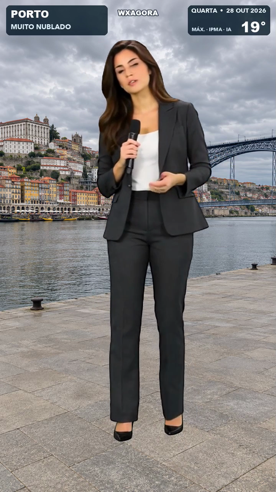

# Portugal em viagem — WXAgora concept

An independent, unofficial proof of concept for a vertical Portuguese weather video. The latest experiment combines a fictional full-body presenter with four weather-specific city backgrounds. The presenter is generated locally as moving video conditioned on locally generated speech; the city images are created with Codex's built-in image-generation tool using that day's forecast. They are AI visualizations, not photographs or live views.



| Example | Forecast date | Approach |
| --- | --- | --- |
| [Full-body presenter](04-full-body-2026-10-28.mp4) | 28 October 2026 | Audio-conditioned local video; forecast-specific generated city images |
| [Earlier talking-photo experiment](03-human-presenter-2026-10-28.mp4) | 28 October 2026 | Older mouth-only animation with archival city photographs |
| [Illustrated video: 28 October](01-28-outubro.mp4) | 28 October 2026 | Moving 2D mascot and fictional miniature |
| [Illustrated video: 29 October](02-29-outubro.mp4) | 29 October 2026 | Moving 2D mascot and fictional miniature |

The full-body example uses an [IPMA snapshot](forecasts/ipma-human-2026-10-28.json) updated at `2026-10-28T13:31:03`: Porto 19°C and heavily cloudy, Lisboa 25°C and partly cloudy, Faro 26°C and partly cloudy, and Ponta Delgada 23°C with showers or rain. These are daily forecasts, not reports of current observed conditions. Generated scenes may not precisely reproduce the real locations or weather.

Source: [IPMA API](https://api.ipma.pt/). IPMA's API terms require attribution and limit free reuse to non-profit purposes; check the current terms and appropriate licence before commercial use. This demonstration is not affiliated with WXAgora or IPMA.

## Full-body experiment

- Speech is generated locally with `tts_eu_pt` 0.1.1, a Kokoro-82M model fine-tuned for European Portuguese. The narration and input plan for the sample are in [audio/2026-10-28-fullbody](audio/2026-10-28-fullbody/). No macOS system voice was used.
- The presenter is a fictional, generated full-body image animated locally with the experimental audio-to-video mode of [ltx-2-mlx](https://github.com/dgrauet/ltx-2-mlx) and LTX-2.3 weights. The voice track used to condition the model is included in the final composite.
- Four separate background images were made with Codex's built-in image tool, using the day's conditions and recognizable city landmarks. The [image manifest](assets/generated/2026-10-28/manifest.json) contains the exact prompts, forecast codes and image hashes; the presenter prompt is in [FULL-BODY.md](FULL-BODY.md).
- The video uses compact top-corner weather graphics and no image-credit footer. City backgrounds and presenter are composited with FFmpeg at 720 × 1280 and 24 fps.

See [FULL-BODY.md](FULL-BODY.md) for setup and the complete manual pipeline. [DAILY-TASK.md](DAILY-TASK.md) describes a repeatable Codex task for fetching each day's forecast, generating new images, producing speech and rendering locally. This is not an installed or unattended daily schedule. The selected video and text-encoder weights require approximately 29 GB of one-time downloads; a short scene took roughly four minutes on the tested 32 GB M5 MacBook Pro. No metered voice or video API was used. Codex image generation, hardware, electricity and other costs are not accounted for as zero.

The video model is experimental. Review the result, especially pronunciation, gestures and speech-to-mouth synchronization, before publishing. There is no automatic social-media posting. This is a proof of concept with four fixed cities, no automatic warning handling and no monitoring; Ponta Delgada represents that city's forecast, not the entire Azores.

## Earlier examples

The older illustrated examples use saved day-0/day-1 IPMA snapshots and locally generated Kokoro speech. Their short music and transition sounds are synthesized by `render.py`; the older illustrated assets' prompts are in [ART-PROMPTS.md](ART-PROMPTS.md). The talking-photo example uses separate archival photographs; their sources and licences are in [THIRD-PARTY.md](THIRD-PARTY.md).

## Legacy: render the illustrated examples again

On a Mac with Python 3.11 and FFmpeg installed:

```sh
cd wxagora-weather-demo
python3.11 -m venv .venv
.venv/bin/python -m pip install Pillow numpy soundfile num2words
.venv/bin/python render.py forecasts/ipma-day0.json rerender-28.mp4
.venv/bin/python render.py forecasts/ipma-day1.json rerender-29.mp4
```

The provided WAV clips are sufficient to reproduce these examples, so the voice model is not required for a re-render. Fonts use the Mac's Arial/Avenir families, with a DejaVu fallback.

## Update the forecast and voice

Install the TTS package in the same environment. Its dependency chain currently includes prereleases:

```sh
.venv/bin/python -m pip install --pre 'tts_eu_pt==0.1.1'
curl -fL 'https://api.ipma.pt/open-data/forecast/meteorology/cities/daily/hp-daily-forecast-day0.json' -o forecasts/ipma-day0.json
curl -fL 'https://api.ipma.pt/open-data/forecast/meteorology/cities/daily/hp-daily-forecast-day1.json' -o forecasts/ipma-day1.json
.venv/bin/python make_speech.py
.venv/bin/python render.py forecasts/ipma-day0.json new-day0.mp4
.venv/bin/python render.py forecasts/ipma-day1.json new-day1.mp4
```

On first voice synthesis, the model is downloaded from [logus2k/kokoro_tts_eu_pt](https://huggingface.co/logus2k/kokoro_tts_eu_pt). Subsequent synthesis is local. The renderer checks that each saved narration line matches the current input values before rendering, and fails instead of silently pairing stale speech with updated data.

This is a proof of concept rather than a production weather system: it has four fixed locations, a finite set of weather descriptions, no automatic warning handling, no publishing scheduler, and no monitoring. IPMA's update timestamp and forecast data should be reviewed before publication. The island scene shows the forecast for Ponta Delgada, not every location in the Azores.

## Legacy: talking-photo prototype

`human_presenter.py` is an earlier talking-photo experiment and is retained for reference. It uses the same Kokoro voice and the [MuseTalk 1.5 MLX port](https://github.com/xocialize/musetalk-mlx) on the Mac's GPU. The presenter image is replaceable: give `--portrait` a front-facing, well-lit image of a person whose likeness you have permission to animate. The included example is a synthetic, fictional person; see [THIRD-PARTY.md](THIRD-PARTY.md) for its source and licence.


This is a talking-photo prototype: MuseTalk changes the mouth area, while the input photo supplies the rest of the face and body. It does not create realistic head motion, expressions, blinking, or a full-body performance. The four city photos are archival, not live footage, and are visibly credited. Check the result, especially the voice and lip sync, before publishing.

On an Apple Silicon Mac with Python 3.11, FFmpeg, and sufficient free disk space:

```sh
cd wxagora-weather-demo
python3.11 -m venv .venv
.venv/bin/python -m pip install --pre \
  'musetalk-mlx @ git+https://github.com/xocialize/musetalk-mlx.git@c6eb30ebd1ed4d043983209813370153de9346bf' \
  'tts_eu_pt==0.1.1' 'mediapipe==0.10.14' \
  'opencv-python<5' 'opencv-contrib-python<5' Pillow num2words
.venv/bin/hf download mlx-community/MuseTalk-1.5-q8 --local-dir .models/musetalk-q8
```

The lip-sync weights are approximately 1.64 GB; the voice model adds roughly 313 MB on its first use. They are downloaded once and are not committed to this repository. Then one command fetches today's IPMA data, writes the narration, lip-syncs the presenter and renders the video:

```sh
.venv/bin/python human_presenter.py --today \
  --model .models/musetalk-q8 \
  --portrait assets/presenter-sample.png \
  --output human-today.mp4 --save-forecast human-today.json
```

This uses no paid speech or video-generation API. The current forecast still requires an internet connection; the local AI models and renderer do not. To reproduce an existing snapshot offline, replace `--today` with `--forecast forecasts/ipma-day0.json`. The `--today` mode rejects a forecast whose date does not match the current date in Lisbon, and the renderer checks narration against the input values. A scheduler can invoke the same command, but no schedule or social-media posting is installed by this project.

By default the mouth is generated and composited at 24 fps. `--lip-fps 12` is available for a faster but less fluid render. The face crop follows MediaPipe landmarks, and the mouth blend is fitted to the detected lips. The exact image and framing matter: inspect the result with any new portrait before publishing. The 15-second sample's lip-sync and composition pass took approximately 255 seconds on an M5 MacBook Pro with 32 GB, excluding speech generation and initial downloads. The sample's credit strip was finalized locally after rendering; the script now writes the same credits directly.
